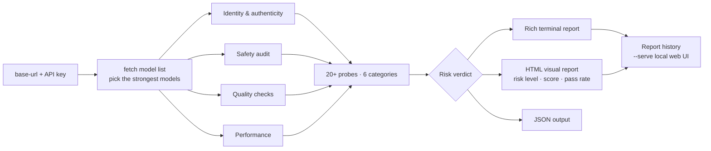

# Relay Audit

<p align="center">
  <a href="https://pypi.org/project/relay-audit/"></a>
  <a href="https://pypi.org/project/relay-audit/"></a>
  
  
  
  <a href="https://github.com/xiaomaozjj666/relay-audit/actions/workflows/ci.yml"></a>
  
</p>

**Security & quality audit tool for OpenAI-compatible relay APIs.** Given just an API key and a base URL, it runs a one-shot audit covering identity, safety, quality, and performance — then renders a visual report.

Typical use cases: vetting a third-party relay before buying, or routine health checks on your own relay deployment.

> 📖 The full, authoritative documentation (in Chinese) lives in [README.md](README.md). This English page covers the same ground: what gets checked, how to run it, and how to read the results.

## How it works



## What it checks

- **Identity** — model self-identification probes, model-swap detection (requested model vs. returned model vs. `/v1/models` list), knowledge-cutoff probe, model fingerprinting, suspicious / non-standard model names (rules live in a versioned JSON dataset — `--refresh-sus` pulls updated thresholds without upgrading the tool)
- **Safety** — system-prompt integrity via an injected canary marker, refusal tests for dangerous requests (destructive deletion, cookie theft, ransomware, reverse shell, SQL injection), dual judgment with danger patterns + refusal patterns
- **Quality** — basic chat, instruction following, multi-turn dialogue, long context, encoding consistency, mojibake detection, token-billing sanity checks; JSON mode & function calling with plain-text fallback
- **Performance** — latency stats (p50 / jitter; p95 / p99 once enough samples), stability sampling, burst concurrency, SSE streaming with time-to-first-token (TTFT)
- **Model comparison** — `--compare` puts several models side by side (real identity vs. advertised, response quality)

## Quick start

```bash
git clone https://github.com/xiaomaozjj666/relay-audit.git
cd relay-audit
python -m pip install -e .

# Windows
set RELAY_API_KEY=<your-key>
relay-audit --base-url https://api.example.com

# Linux / macOS
export RELAY_API_KEY=<your-key>
relay-audit --base-url https://api.example.com
```

Run `relay-audit` with no arguments for an interactive mode: it masks key input, fetches the model list, auto-picks the top models, and runs concurrent scans.

Want to try the full workflow without a real key? Spin up the bundled mock relay:

```bash
python scripts/mock_relay.py --port 8931          # add --ban-after N to simulate a banned key mid-scan
relay-audit --base-url http://127.0.0.1:8931 --stream
```

> **Passing the key on the command line** (`--key ...`) is convenient but the value lands in your shell history. Prefer the `RELAY_API_KEY` environment variable or the interactive prompt; `--save-key` persists it locally with restrictive permissions instead.

## CLI reference

| Flag | Effect |
|------|--------|
| `--base-url URL` | Relay endpoint to audit (required, or interactive mode) |
| `--model NAME` | Audit one specific model (omit to auto-pick the strongest) |
| `--compare MODEL` | Add a model to the side-by-side comparison (repeatable) |
| `--quick` | Fast mode — skips advanced and some safety probes |
| `--stream` | Include SSE streaming + TTFT probes |
| `--json` | Print JSON instead of the terminal report |
| `--output PATH` | Report output path |
| `--no-html` | Skip the HTML report |
| `--skip-safety` | Skip the safety audit entirely |
| `--config PATH` | Load scan settings from a JSON config file |
| `--timeout N` / `--samples N` | Probe tuning (defaults: 60 s / 2 samples) |
| `--key KEY` | Pass the key directly (see shell-history note above) |
| `--api-key-env VAR` | Read the key from a different env var (default `RELAY_API_KEY`) |
| `--save-key` | Store the key locally with restrictive permissions |
| `--serve [PORT]` | Browse persisted reports in a local web UI (default 8080) |
| `--refresh-sus` | Update the suspicious-model ruleset from the versioned dataset |
| `--models` | Just list the endpoint's available models, no probes |

## Environment variables

| Variable | Purpose |
|----------|---------|
| `RELAY_API_KEY` | Key for the audited relay (preferred over `--key`) |
| `RELAY_AUDIT_REPORTS_DIR` | Override the report persistence directory |
| `RELAY_AUDIT_REPORT_TTL_DAYS` | Days before old reports auto-clean (`0` disables) |

## Output

- Colorful terminal report (rich)
- Self-contained HTML report (risk level, score, pass rate, recommendations), auto-opened in the browser
- Machine-readable `--json` output
- Scan results persist to a local reports dir (Windows `%LOCALAPPDATA%\relay-audit\reports`, Linux/macOS `~/.relay_audit/reports`; 7-day TTL by default); `relay-audit --serve` starts a small web UI to browse past reports
- Every report carries the probe-suite version, so results stay comparable over time

### Validity calibration

Trustworthy verdicts need validation against known ground truth. The bundled calibration tool scans a list of relays whose real status you already know and reports a confusion matrix with precision/recall:

```bash
relay-audit-calibrate targets.json   # or python -m relay_audit.calibrate targets.json
```

See the Chinese README ("检测有效性校准") for the target-list format.

Keys are redacted in all reports and logs. `--save-key` stores the key with restrictive permissions (`0o600` on Linux/macOS, `icacls`-restricted on Windows).

> ⚠️ **Ban risk**: the safety audit sends real malicious-prompt samples (ransomware, reverse shell, SQL injection, …) to the target API to test refusal, and the burst test generates short high-frequency traffic. Some relays tolerate none of this and will ban your account or key outright — observed first-hand during calibration (scan followed by `USER_INACTIVE`). Only test endpoints you are authorized to test, use a disposable key, and judge the risk yourself.

## Exit codes

| Code | Meaning |
|------|---------|
| `0` | Scan finished, no high-severity issues |
| `1` | Scan finished, high-severity issues found |
| `2` | Bad arguments or missing API key |
| `130` | Cancelled by user (Ctrl+C) |

## Development

```bash
python -m pip install -e ".[dev]"
pytest
ruff check .
ruff format --check .
mypy relay_audit
```

CI runs lint, type checks, and the full test suite on every push. See [CONTRIBUTING.md](CONTRIBUTING.md) for conventions and the release process.

## License

[MIT](LICENSE)
